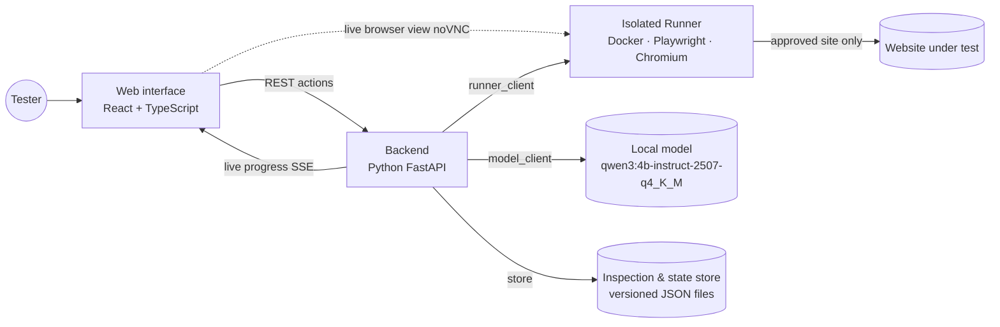
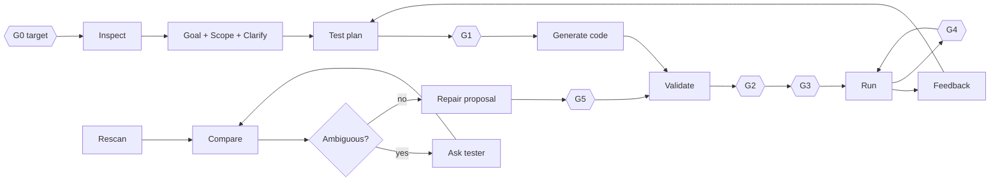

# Human-in-the-Loop Web Testing Assistant: Design Document (Phase 1)

*Status: Phase 1 design, Week 9. The measured figures in §7 come from the Phase 1 benchmark (`docs/resources.md`).*

## 1. Overview

The assistant helps a human tester inspect a web page, design test cases, generate Playwright tests, run approved tests, and maintain those tests when the page changes. Two principles shape the design:

1. **Evidence first.** Deterministic code extracts everything the system knows about a page from the live DOM. The language model only *interprets* that data. Every claim it makes must cite an observed element. If a claim can't be backed by evidence, the system withholds it instead of showing it.
2. **The human decides.** The model proposes, explains and asks. Code checks facts. The tester approves every step that runs, generates or changes something. The model never chooses the next action, and it has no tools.

Phase 1 delivers inspection, guided interaction and a grounded model call. It is built on the same storage, approval and runner design that Phase 2 uses.

## 2. Components



| Component | Responsibility |
|---|---|
| **Web interface** (React, TypeScript, Vite) | Annotated screenshot, Findings table and detail panel, Testing goal, Scope selection and filters, clarification chat, assistant responses with evidence links and usage badges, approval buttons, a live view of the Runner's browser. |
| **Backend** (Python, FastAPI) | One folder per feature (`v1/inspection`, `v1/session`, `v1/assistant`, … `v1/maintenance`). Shared helpers in `utils/`. It owns all state and enforces every approval gate. |
| **Model integration** (`model_client` + `agent_loop`) | A hand-written agent loop with no agent framework: build a grounded prompt → call the model → validate → retry or block → respond or ask. `model_client` is the only code that talks to the model, and it logs every call. |
| **Inspection & state store** (`store`) | Versioned JSON files on disk. Every Inspection, test plan, code version, run and approval is kept, so later steps refer to what was actually observed. |
| **Isolated Runner** (Docker) | Opens pages in a headed Chromium, extracts elements and verifies locators, and in Phase 2 runs the generated tests. It has no access to host files and can reach only the approved site. |
| **Shared contracts** (`contracts/`) | One definition of every shared data shape (Finding, Inspection, run result, …), used by both the backend and the Runner. The frontend's TypeScript types are generated from it. |

## 3. Data flow: Phase 1

```mermaid
sequenceDiagram
  actor T as Tester
  participant UI
  participant BE as Backend
  participant RN as Runner
  participant M as Local model
  T->>UI: Enter URL, Start inspection
  UI->>BE: POST /inspection
  BE->>BE: Record approval G0 for the site's origin
  BE->>RN: inspect(url, allowed origins)
  RN->>RN: Load page in a visible browser, extract elements, rank and verify locators
  RN-->>BE: Findings + screenshot
  BE->>BE: Store the Inspection (never changed afterwards)
  BE-->>UI: Findings table + numbered screenshot
  T->>UI: Write a Testing goal, select elements and filters (Scope)
  UI->>BE: Ask for a Scope summary
  BE->>BE: Compute confidence; if the goal is unclear, ask a clarification question
  BE->>M: Grounded prompt (Findings in Scope as data) + JSON schema
  M-->>BE: JSON response citing Finding IDs
  BE->>BE: Validate against the Inspection → retry (up to 2) → block unsupported claims
  BE->>BE: Log a model call record (tokens, time) for every attempt
  BE-->>UI: Observed / Inferred meaning / Unverified / Next step + usage badge
```

**Inspection output.** Each Finding records the tag, type, accessible name, visible text, exact DOM attributes, visibility, position, its containing form or landmark, a fingerprint, and ranked locator candidates. Each candidate shows its live match count and a reliability rating. Locators prefer `get_by_role` / `get_by_label`, then test IDs, then CSS. XPath and positional selectors are never suggested automatically. Any candidate that doesn't match exactly one element is ranked down. A sample export is in `docs/samples/inspection.json`.

**Failure handling.** Each failure has its own state (unreachable, timeout, login required, partial) and keeps whatever was captured. The system never invents a Finding for an element it couldn't inspect. If a page requires login, the tester signs in by hand in the visible Runner browser and runs the inspection again. The system never asks for or stores the tester's credentials.

## 4. Approval gates

Approvals point at one **exact version** of an artifact, using its content hash. Editing something after approval creates a new, unapproved version, and the gate locks again. Every gate is enforced by the backend (`gates.require`), not just by the UI.

| Gate | When | What the tester approves |
|---|---|---|
| **G0 Target** | Starting an inspection (Phase 1) | That the Runner may load this site's origin. Moving to a different origin needs a new approval. |
| **G1 Test plan** | Before code generation | The test cases, their steps and expected results. Blocked while any expected result is still an unconfirmed assumption. |
| **G2 Code review** | After generation and validation | The generated Page Object Model code, shown read-only. Changes are made as structured edits that create a new version. |
| **G3 Execute** | Before running | Running exactly this code version in the Runner. |
| **G4 Rerun** | After feedback or revision | Running again. |
| **G5 Repair** | Maintenance, after a rescan | A proposed locator repair, shown with its evidence (old vs new element). |
| **Clarification** | Any time the evidence is insufficient | Answering the assistant's question, or explicitly skipping it. An unclear goal and an ambiguous rescan match both stop the workflow until the tester responds. |



## 5. Validation points

| Where | Check | Phase |
|---|---|---|
| Assistant output | Output follows the JSON schema. Every cited Finding exists and is in Scope. Every quoted attribute matches the DOM exactly. A failed check is retried with the errors fed back (2 retries by default). Claims that still fail are removed, and the tester sees a notice that content was withheld. | 1 |
| Locators | Live match count. Only locators that match exactly one element can be ranked best. | 1 |
| Clarification | Code computes a confidence score from observable signals (does the goal mention real elements? is the Scope non-empty? does it name an action?), not the model's opinion of itself. Below the threshold, the assistant asks. | 1 |
| Generated code | Python syntax (`ast.parse`), the `ruff` linter, and an import allowlist (no `os`, `subprocess`, `socket`, `eval`). | 2 |
| Generated locators | Each locator must exist among the stored Findings **and** match exactly one element on the live page before execution. | 2 |
| Repairs | A repair may change locators only. Steps and assertions must stay identical, so test intent is preserved and an assertion is never weakened to make a test pass. | 2 |

## 6. From inspection to generation, execution and maintenance

Stored Inspections are the foundation for Phase 2:

1. **Test design.** Test cases are built from Findings in Scope plus the tester's requirements. Each expected result is labeled *observed*, *tester-confirmed* or *assumption*, and assumptions must be confirmed before G1.
2. **Generation.** The Page Object classes are generated **from templates**, using the verified locator candidates of the stored Inspection. The model fills in only the test steps and assertions, as JSON. That keeps the 4B model away from writing whole files and inventing locators.
3. **Execution.** The approved code version is copied into the Runner as a fixed, hash-checked job. Each test run uses a fresh browser context. Results include pass/fail, durations, error details, screenshots and traces. Real application failures stay visible.
4. **Maintenance.** When the tester asks, a rescan creates a **new** Inspection and compares it with the stored one by fingerprint (role, accessible name, container, key attributes), using deterministic scoring. A clear match becomes a repair proposal with evidence. If the two best candidates score too close together, the assistant asks the tester which one is right. The model only explains the candidates.
5. **Versioning.** Test plans and code are append-only versions. Each one records the versions it was derived from (code v2 ← plan v3 ← Inspection X). The tester can diff any two versions and restore an earlier one. A restore creates a new version, so no history is lost.

## 7. Model and resource assumptions

| Item | Setup |
|---|---|
| Model | `qwen3:4b-instruct-2507-q4_K_M` (~2.5 GB), served by **Ollama** locally. It is the only model the project uses, for both the assistant and the codegen role. No paid APIs. |
| Settings | Thinking off, 8k context (`num_ctx=8192`), structured JSON output via Ollama `format` |
| Hardware | RTX 3060 Laptop GPU (6 GB VRAM), i7-11800H, 14 GB RAM. The model runs fully on the GPU. |
| Cloud fallback | Off by default. A free-tier API can be enabled in config; its calls are throttled to the provider's rate limits and labeled as cloud calls. |
| Token counts | Taken from Ollama's own counts (`prompt_eval_count`, `eval_count`). Any estimate is labeled as an estimate. |
| Timing | Model response time, model load time and browser/test time are recorded and shown separately. Session and page averages count fresh calls only, never reused results. |

**Practical limits.** The 6 GB of VRAM allows one ~4B model at a time with about 8k of context. Prompts therefore include only the Findings in Scope plus a condensed history. Large pages need Scope filtering.

**Measured figures (Phase 1 benchmark, 2026-11-20, Ollama 0.40.16, RTX 3060 Laptop).** 16 Scope-summary cases on 3 real Inspections (login, signup and search pages with 16, 13 and 15 Findings), run through the real agent loop and `model_client`; num_ctx 8192, temperature 0.2, 2 retries. Full table, method and raw data: `docs/resources.md` and `docs/benchmark-results.json`.

| Metric | Value |
|---|---|
| Model size on disk | 2.5 GB |
| Peak VRAM while running | 3,893 MiB of 6 GB (whole GPU, incl. desktop), 100% on the GPU |
| JSON valid on the first attempt | 100% of 16 cases |
| Grounding validation passed (no claim blocked) | 100% of 16 cases |
| Mean retries per answer | 0.1 |
| Response time per call, mean / p95 | 3.9 s / 9.0 s |
| Response time per answer (all attempts), mean / p95 | 4.2 s / 9.0 s |
| Generation speed | 66.5 tokens/s |
| Cold load (model from disk to GPU) | 4.0 s. The backend sends a warm-up call at startup and keeps the model loaded for 30 min. |

**Response-time target (NFR-3):** a validated Scope summary within 15 s at p95 with the model warm. The measured p95 is 9.0 s, so the target leaves some headroom. A cold start adds the load time.

Per-call usage records from a demo session are in `docs/samples/model_calls.json`. They show tokens, response and load time, and the validation outcome, and include one attempt that failed validation and was retried.

## 8. Isolation and safety

- **Runner isolation.** The Runner runs in a Docker container as a non-root user, with all capabilities dropped, a read-only filesystem and memory and process limits. It sees only a shared volume for exchanging jobs and results with the backend, and none of the host's files. Its API is reachable only from the backend.
- **Target restriction.** The browser blocks every request outside the approved origins (G0). Generated tests can't open sockets or run commands, because the import allowlist forbids it.
- **Webpage content is data.** Page text enters prompts only as quoted JSON inside marked data blocks, and the system prompt states that it is never instructions. The model has no tools, so even a hostile page can't trigger an action.
- **Secrets.** No API keys in the repository. An optional cloud key lives in a gitignored `.env`.

## 9. Deployment

`docker compose up` starts the frontend, backend and Runner on Linux, macOS and Windows. Ollama runs natively on each laptop so it can use the GPU (CUDA or Apple Metal), and the containers reach it through `host.docker.internal`. The Runner's browser is visible through a noVNC view embedded in the interface, which works the same on all three operating systems.

## 10. Known limitations

- A 4B model is weaker at long reasoning and code than larger models. This is why code generation relies on templates and the model fills only steps and assertions.
- Single tester, single machine. There's no multi-user support and no hosting.
- Pages behind a login during *test runs* (not during inspection) aren't handled yet. This is planned for Phase 2.
- Rescan matching uses attributes and structure. A complete page redesign will mostly produce clarification requests rather than automatic repairs, by design.
- Embedding the live browser view adds some setup inside the Runner image (Xvfb and noVNC).
